### Hao-Fu Chang · AI Product Engineer

Backend engineer who builds LLM products end to end, from the user need to the LLM backend. 2.5 years shipping backends for enterprise AI SaaS and an LLM EdTech startup. Based in Taichung, Taiwan; open to remote and relocation.

**▶ [Open the interactive map](https://blacktea3250106.github.io)** to walk through my work, builds and skills as a little pixel RPG. Prefer plain text? It has a read mode.

| Build | What it shows |
|---|---|
| [lumi-ai-customer-service](https://github.com/blacktea3250106/lumi-ai-customer-service) | Claude tool-use loop with verified order lookup, image recognition and an admin console |
| [dream-journal](https://github.com/blacktea3250106/dream-journal) | Consumer AI app: Next.js, Supabase row-level security, prompt caching |
| [vocab-pipeline](https://github.com/blacktea3250106/vocab-pipeline) | Photos to a study app: Claude vision structured extraction, Batch API, validation layer |
| [agent-workflow](https://github.com/blacktea3250106/agent-workflow) | Measured fixes for a stalled multi-agent coding session: job lock, health check, acceptance gates |
| [pet-to-character](https://github.com/blacktea3250106/pet-to-character) | Evaluation-driven pipeline from a pet photo to a rigged 3D game character |

**Work** · MaiAgent, enterprise AI SaaS (2024–26) · Wisdome.AI, LLM EdTech (2023–24)

**Stack** · Python · Django · PostgreSQL · Celery · LlamaIndex · AWS · GCP · Azure

[LinkedIn](https://www.linkedin.com/in/haofuchang) · [Interactive map](https://blacktea3250106.github.io)
